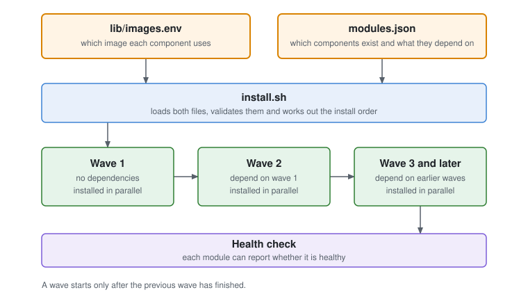
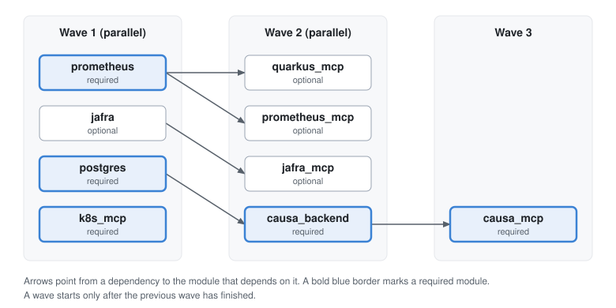
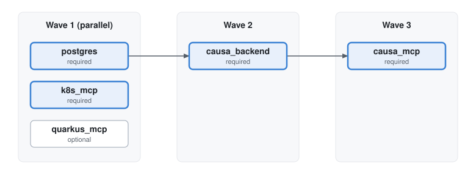

# Architecture

How the Causa RCA Installer works internally.
For installation steps, see the [Installation Guide](installation.md).

## Overview

The installer is a modular Bash project. A single entry point orchestrates the deployment by delegating each component to its own dedicated script. No component script is aware of the others — all coordination happens in the main orchestrator.

```
install.sh                              ← entry point, orchestrates everything
lib/
  images.env                            ← default image tags — the only place images are declared
  images.sh                             ← derives vars, flags, --help and validation from images.env
  logging.sh                            ← logging utilities and spinner
  install_utils.sh                      ← shared helpers, exit codes, error handling
  validator.sh                          ← pre-flight checks (tools, container runtime, cluster)
  install_kind_cluster.sh               ← Kind cluster + local registry (kind only)
  install_prometheus.sh                 ← Prometheus Stack via Helm (kind only)
  enable_monitoring.sh                  ← OpenShift UWM + Alertmanager webhook config (openshift only)
  install_cert_manager.sh               ← cert-manager via official release manifest (kind only)
  install_k8s_mcp.sh                    ← Kubernetes MCP Server
  install_jafra.sh                      ← Jafra Ecosystem (kind only)
  install_jafra_mcp.sh                  ← Jafra MCP Server (kind only)
  install_quarkus_mcp.sh                ← Quarkus MCP Server
  install_postgres.sh                   ← PostgreSQL — standalone Deployment (kind) / CloudNativePG (openshift)
  install_causa.sh                      ← Causa Backend
  install_causa_mcp.sh                  ← Causa MCP Server
manifests/
  k8s_mcp_server.yaml                   ← Kubernetes MCP Server (NodePort 30000)
  causa/deployment.yaml                 ← Causa Backend (NodePort 30001, kind)
  jafra/                                ← Jafra Ecosystem (kind only)
  jafra_mcp/deployment.yaml             ← Jafra MCP Server (NodePort 30003, kind only)
  quarkus_mcp/deployment.yaml           ← Quarkus MCP Server (NodePort 30004)
  causa_mcp/deployment.yaml             ← Causa MCP Server (NodePort 30005)
  postgres/                             ← kind Deployment + OpenShift CNPG operator manifests
  openshift/                            ← OpenShift-specific manifests (Routes, Causa Backend, monitoring)
  prometheus/                           ← PrometheusRule (applied on both targets)
```

## Startup sequence

When `install.sh` is run:

1. Loads default images from `lib/images.env`
2. Parses CLI arguments — flags override env vars which override `lib/images.env`
3. Initialises the log file
4. Runs pre-flight validation (container runtime, tools, cluster access)
5. Deploys components in sequence (see [Installation order](installation.md#installation-order))
6. Runs post-installation health check and prints the access summary

## Module registry (`modules.json`)

Deployable components are declared in [`modules.json`](../modules.json) and run by [`lib/module_runner.sh`](../lib/module_runner.sh). Adding a component means adding an entry and a `lib/install_*.sh` — `install.sh` is not edited. Requires `jq`.

| Field | Meaning |
|---|---|
| `id` | Unique key (`[a-z0-9_]+`), referenced by `depends_on` |
| `name` | Display name used in progress output and the summary |
| `source_lib` | Library sourced by the registry (path relative to the installer root). Only sourced when the module matches `INSTALL_TARGET` |
| `install_fn` / `uninstall_fn` | Functions defined by `source_lib` |
| `targets` | `["*"]` for every target, or a list of `kind` / `openshift`. Non-matching modules are not sourced or installed; they are listed once in the install log under "Modules not applicable to target" and not shown on the terminal |
| `required` | `true`: an install failure aborts the installer. `false`: warn and continue |
| `depends_on` | Module ids that must be installed first |

<<<<<<< Updated upstream
- **Waves:** a module runs in a later wave than all of its dependencies. Modules in the same wave run **concurrently**, each in its own process group; a wave finishes when all of its modules have finished, and the next wave starts only then. Each module's output is buffered and printed in `modules.json` order once the wave ends, so it is never interleaved. If a `required` module fails, the still-running modules of that wave are terminated (including any processes they spawned) and no later wave starts. Ctrl-C / `SIGTERM` terminates the whole wave the same way. Modules must therefore not rely on a sibling in the same wave having run first — declare such a need with `depends_on`. Uninstall runs sequentially in reverse order.
- **Dependency not installed:** a dependent of a failed or skipped module is skipped with a warning — or aborts the installer if the dependent is `required`.
- **Dependency filtered out by target:** a dependency whose `targets` do not include the selected target can never be installed there, so it is ignored and does not block its dependents. For example, `quarkus_mcp` depends on `prometheus` (Kind only); on OpenShift, where Prometheus is the built-in monitoring stack, `quarkus_mcp` still installs. Likewise `jafra_mcp` (depends on `jafra`) and `prometheus_mcp` are Kind-only themselves, so they are filtered out on OpenShift.
- **Health checks:** nothing is declared in `modules.json`. After the install, `post_component_validation` calls `registry_check_health`, which looks for a function named `<id>_health` (for example `k8s_mcp_health`, `postgres_health`) defined by the module's own `source_lib`. Exit `0` means healthy; anything printed to stdout is shown as the failure detail. A module without one is not checked, a module whose install was skipped or failed is reported as "not installed", and modules not applicable to the target are omitted. `check_deployment_healthy <deployment>` in `lib/install_utils.sh` covers the common case of a plain Deployment. The check is skipped on `--dry-run`, since nothing is deployed.
- **Skipped installs:** an `install_fn` that deliberately deploys nothing (for example, its image is unset) returns exit status `2`. The runner does not log it as installed or list it in the summary, and its dependents are skipped. Exit `0` means deployed (or a dry run); any other non-zero status is a failure.
- **Validation:** `modules.json` is validated before any cluster work (JSON, `schema_version`, field types, duplicate ids, unknown dependencies, cycles, missing `source_lib` / functions).
- **Not in the registry:** manifest paths stay in each `source_lib`; image variables live only in `lib/images.env` (see [Image resolution](#image-resolution)). Kind cluster provisioning, cert-manager and OpenShift monitoring remain in `install.sh`.

### Adding a new component

1. **Script:** create `lib/install_<name>.sh` defining the install and uninstall functions (and optionally `<id>_health`), plus its `manifests/<name>/`.
2. **Registry:** add one entry to `modules.json` (`id`, `source_lib`, `install_fn`, `uninstall_fn`, `targets`, `required`, `depends_on`).
3. **Image (if any):** add one entry to `lib/images.env` — see below.

`install.sh` and `lib/validator.sh` are not edited.

=======
### Wave architecture

Two files describe the whole installation:

- [`lib/images.env`](../lib/images.env) describes **which image** each component uses.
- [`modules.json`](../modules.json) describes **which components** exist and what they depend on.



`install.sh` loads both files, then installs the modules in waves. A module's wave is 1 plus the highest wave among its dependencies, and a module with no dependencies is in wave 1. Modules inside a wave install in parallel. A wave starts only after the previous wave has finished.

#### Waves on the Kind target

Arrows point from a dependency to the module that depends on it.



#### Waves on the OpenShift target

`prometheus`, `jafra`, `jafra_mcp` and `prometheus_mcp` list only `kind` in `targets`, so they are neither sourced nor installed. Waves are computed for the selected target, and a dependency that does not apply to it is ignored. `quarkus_mcp` depends on `prometheus`, which is pre-installed on OpenShift, so it moves to wave 1 and installs in parallel with `postgres` and `k8s_mcp`.



### Runtime behaviour

| Situation | Result |
|---|---|
| A wave runs | Modules run concurrently. Their output is buffered and written to the log in `modules.json` order after the wave ends. Modules must not rely on a sibling in the same wave, so declare the need with `depends_on` |
| A `required` module fails | The rest of the wave is stopped, no later wave starts, and the installer exits 1. Ctrl-C and `SIGTERM` stop the wave the same way |
| An optional module fails | Warning, and the install continues. Its dependents are skipped, or the installer aborts if a dependent is `required` |
| `install_fn` returns `2` | Skipped on purpose (for example, its image is unset). It is not listed as installed, and its dependents are skipped. `0` is success, and any other non-zero value is a failure |
| A dependency does not apply to the target | Ignored: it neither blocks the dependent nor delays its wave. `quarkus_mcp` is in wave 2 on Kind and wave 1 on OpenShift |
| Health check | After the install, `registry_check_health` runs each module's `<id>_health` function if it has one. Exit `0` means healthy. Nothing is declared in `modules.json`. See `check_deployment_healthy` in `lib/install_utils.sh` |
| `--terminate` | Runs `uninstall_fn` one module at a time, in reverse order |
| `--dry-run` | Validates and walks the waves without deploying. Health checks are skipped |

`modules.json` is validated before any cluster work: JSON, `schema_version`, field types, duplicate ids, unknown dependencies, cycles, and missing `source_lib` or functions.

**Not in the registry:** manifest paths (each `source_lib` owns them), image variables (see [Image resolution](#image-resolution)), and Kind cluster, cert-manager and OpenShift monitoring setup (`install.sh`).

### Adding a new component

Add the manifests, a `lib/install_<name>.sh`, one entry in `modules.json` and, if the component has an image, one entry in `lib/images.env`. `install.sh` and `lib/validator.sh` are not edited. If Causa should call the new MCP server, also register it in the two `mcp.json` files. See [Adding a new component](adding-a-component.md) for the steps, an example and a checklist.
>>>>>>> Stashed changes

## Target-specific behaviour

The `--target` flag (default: `kind`) controls which infrastructure steps run:

| Step | Kind | OpenShift |
|---|---|---|
| Cluster provisioning | Creates Kind cluster + local registry | Skipped — connects to existing cluster |
| Prometheus | Installs kube-prometheus-stack via Helm | Skipped — uses built-in UWM |
| cert-manager | Installs from official release manifest | Must be pre-installed (validated before deploy) |
| Alertmanager webhook | Configured via kube-prometheus-stack | Configured via UWM Secret or platform Alertmanager patch |
| Jafra Ecosystem | Deployed (if images set) | Skipped — not supported |
| Jafra MCP Server | Deployed (if image set) | Skipped — not supported |
| PostgreSQL | Standalone Deployment + pgvector | CloudNativePG operator via OLM Subscription |
| Causa Backend | NodePort Service | Deployment + OpenShift Route |
| Kubernetes MCP Server | NodePort Service | Deployment + OpenShift Route |
| Quarkus MCP Server | NodePort Service | ClusterIP (OpenShift) |
| Causa MCP Server | NodePort Service | Deployment + OpenShift Route |

## Image resolution

Every component image is resolved in this priority order:

```
CLI flag  >  exported env var  >  lib/images.env
```

`lib/images.env` uses `${VAR:-value}` syntax, so any value already exported in the environment before the script runs is preserved. There are no hardcoded image fallbacks in the component scripts — `lib/images.env` is the single source of truth.

### Adding or changing an image

Edit only `lib/images.env`:

```bash
# Widget Service
WIDGET_SERVICE_IMAGE=${WIDGET_SERVICE_IMAGE:-quay.io/org/widget:1.0.0}
```

[`lib/images.sh`](../lib/images.sh) discovers every `^[A-Z][A-Z0-9_]*_IMAGE=` line and derives the rest:

| Derived | From | Example |
|---|---|---|
| CLI flag | variable name, lowercased with `-` | `--widget-service-image` |
| `--help` text | comment on the line above (text from ` (` onwards dropped) | `Override Widget Service image` |
| Override sentinel | variable name | `WIDGET_SERVICE_IMAGE_OVERRIDDEN` |
| Format validation | every discovered variable | `validate_image_overrides` |

To change a default tag, edit the value in `lib/images.env`. The component script reads `${WIDGET_SERVICE_IMAGE}` directly.

## Container runtime detection (kind only)

The validator detects the available container runtime automatically:

1. Prefers **Podman** if `podman` is available and responding
2. Falls back to **Docker**, with a check to detect if `docker` is actually a Podman shim
3. Exports `CONTAINER_RUNTIME` (`docker` or `podman`) for use by the Kind cluster script

## PostgreSQL setup

### Kind — standalone Deployment

`install_postgres.sh` deploys two Kubernetes Secrets before starting the workload:

| Secret | Keys |
|---|---|
| `postgres-credentials` | `POSTGRES_DB`, `POSTGRES_USER`, `POSTGRES_PASSWORD` (used by the Pod) |
| `causa-db-secrets` | `CAUSA_DB_USERNAME`, `CAUSA_DB_PASSWORD`, `CAUSA_DB_URL` (read by Causa) |

The pgvector extension is initialised at startup via a ConfigMap-mounted SQL script.

### OpenShift — CloudNativePG operator

`install_postgres.sh` installs the CloudNativePG operator via OLM (Subscription + InstallPlan approval), then applies the `iri-db` Cluster CRD. Once the cluster is healthy, credentials are read from the CNPG-generated `iri-db-app` Secret and re-exposed as the `causa-db-secrets` Secret that Causa reads.

## OpenShift monitoring

On OpenShift, `enable_monitoring.sh` handles Prometheus integration instead of installing a separate stack:

1. Enables User Workload Monitoring (UWM) by patching `cluster-monitoring-config`
2. Detects the Alertmanager topology:
   - **Topology A** — UWM Alertmanager present (`alertmanager-user-workload`): configures it directly via its own Secret
   - **Topology B** — platform Alertmanager only (`alertmanager-main`): merges the `causa-webhook` receiver into the existing config using `python3` + PyYAML
3. Applies a `PrometheusRule` with Causa alert definitions
4. Applies a `NetworkPolicy` allowing Alertmanager and the OpenShift ingress router to reach Causa on port 8080

## Causa — MCP endpoint configuration

After the Causa deployment becomes ready, `install_causa.sh` stamps three env vars
onto the running deployment using `kubectl set env` (idempotent — safe on every re-run):

| Env var | Value | Source |
|---|---|---|
| `CAUSA_MCP_QUARKUS_ENDPOINT` | `http://mcp-metrics.<ns>.svc.cluster.local:8080` | Derived from `INSTALL_NAMESPACE` |
| `CAUSA_MCP_QUARKUS_METRICS_BASE_URL` | user-supplied URL | `CAUSA_MCP_QUARKUS_METRICS_BASE_URL` env var (default: `""`) |
| `CAUSA_MCP_ASYNC_PROFILER_ENDPOINT` | `http://jafra-mcp.<ns>.svc.cluster.local:8083` | Derived from `INSTALL_NAMESPACE` |
| `JAFRA_ANALYZER_URL` | `http://jafra-analyzer.<ns>.svc.cluster.local:8080` | Derived from `INSTALL_NAMESPACE` |

`kubectl set env` triggers a new rollout. The installer then waits up to 180 s for
`kubectl rollout status deployment/causa-backend` to confirm the pods are running the
new configuration before proceeding.

## Manifest substitution

Each manifest contains placeholder tokens that are substituted at apply time using `sed`:

| Placeholder | Replaced with |
|---|---|
| `PLACEHOLDER_NAMESPACE` | `INSTALL_NAMESPACE` |
| `PLACEHOLDER_CLUSTER_TYPE` | `INSTALL_TARGET` (e.g. `kind` or `openshift`) |
| `PLACEHOLDER_QUARKUS_METRICS_BASE_URL` | `CAUSA_MCP_QUARKUS_METRICS_BASE_URL` (may be empty) |

The standard `apply_manifest` helper in `lib/install_utils.sh` handles `PLACEHOLDER_NAMESPACE`
and `PLACEHOLDER_CLUSTER_TYPE`. The `PLACEHOLDER_QUARKUS_METRICS_BASE_URL` substitution is
applied automatically for the Causa manifests during installation.

## Optional components

The Jafra Ecosystem, Jafra MCP Server, and Quarkus MCP Server are deployed only when their
images are set in `lib/images.env`. If any required image variable is empty, the installer
skips that component with a warning rather than failing.

Jafra (Ecosystem + MCP Server) is additionally gated by target: these components are
**skipped entirely on OpenShift** regardless of image settings.
